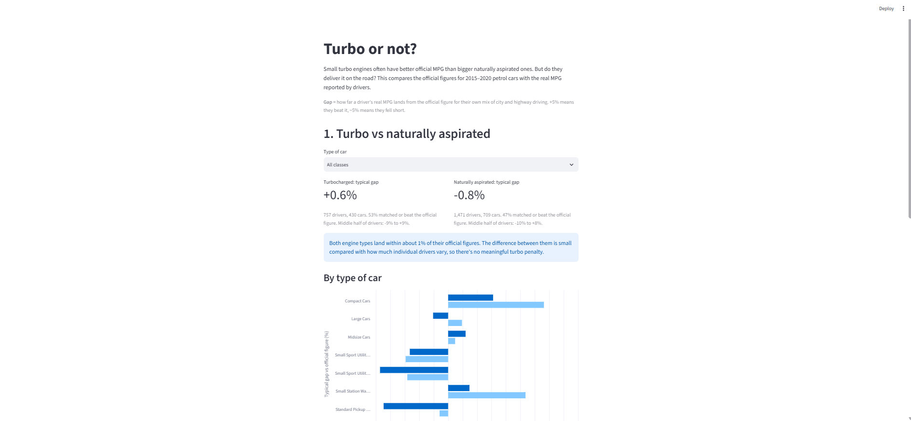
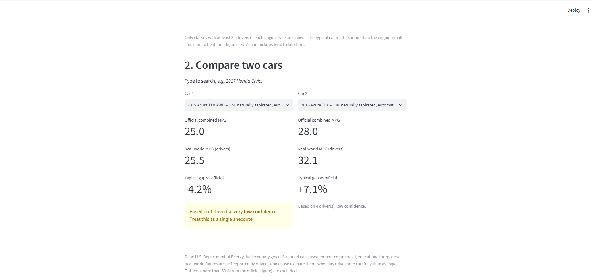

# Turbo vs Reality

Do turbocharged petrol cars deliver their official fuel economy in real-world driving, compared with naturally aspirated cars?

Short answer: yes. For 2015–2020 petrol cars, drivers' real-world MPG lands within about 1% of the official figure for both engine types, once each driver's mix of city and highway driving is accounted for. The type of car matters more than the engine: small cars tend to beat their figures, while SUVs and pickups tend to fall short.



---

## What I built and who for

Who it's for: someone buying a used car who is choosing between a small turbocharged engine and a larger naturally aspirated one. The turbo usually has better official MPG, but a common worry is that turbos only deliver it in lab tests, not on the road.

What I built: a data pipeline that pulls official EPA fuel economy figures and real-world MPG reported by drivers from the U.S. Department of Energy's fueleconomy.gov API, shapes them into a small data model in DuckDB, and compares each driver's real MPG against what the official figures predict for their own driving. A Streamlit app then answers two questions for the buyer:
1. In general, does the turbo's official advantage hold up, overall and for the type of car they want?
2. For the two specific cars they're considering, what do real drivers get, and how far can that be trusted?

What the buyer would do differently: instead of avoiding a turbo for fear it won't match its figures, they can compare engines on official MPG with reasonable confidence. If real-world economy matters to them, they should pay more attention to the type of car, since SUVs and pickups are where the official figures tend to overstate.

What I left out on purpose:
- Diesel, hybrid, plug-in hybrid, electric and flex-fuel cars. Different fuels and units (diesel has more energy per gallon, EVs report MPGe), and none of them fit a turbo vs naturally aspirated question.
- Supercharged and twincharged cars. Only 21 in range, too few to compare reliably. Their counts are still reported.
- Model years outside 2015–2020, when small turbos became common.

---

## The data

Source: U.S. Department of Energy, fueleconomy.gov web services. Documentation: https://www.fueleconomy.gov/feg/ws/index.shtml

Licence: the site's copyright statement allows its documents to be "freely distributed and used for non-commercial, scientific and educational purposes". This is a non-commercial, educational project. Vehicle photographs are copyrighted separately, but the pipeline doesn't fetch any.

What I pulled (fetched 19 October 2026):

| Endpoint | What it returns | Responses |
|---|---|---|
| `/ympg/shared/menu/make` | Makes with driver-submitted data | 1 (71 makes) |
| `/ympg/shared/menu/model?make=` | Models for each make | 71 |
| `/ympg/shared/vehicles?make=&model=` | Near-complete vehicle records (official MPG, engine, turbo/supercharger flags, fuel type) | 2,380 lists, 14,450 vehicles |
| `/ympg/shared/ympgDriverVehicle/{id}` | Individual driver records (MPG, city/highway split, state, date) | 1,519 vehicles, 3,325 driver records |

About the API: no key or authentication is needed, results aren't paginated (each menu returns everything at once), and no rate limits are published, so I set my own delay between requests. Responses default to XML; sending `Accept: application/json` returns JSON. Every value arrives as text, empty values are empty strings rather than nulls, and a list with one item comes back as a single object rather than a list.

---

## How it works

```
fueleconomy.gov API
      │  extract/fetch.py
      ▼
data/raw/*.jsonl  raw responses, untouched (committed)
      │  pipeline.py runs transform/*.sql in order
      ▼
01_staging.sql    typed tables, one row per vehicle / driver record
      ▼
02_clean.sql  scope rules, engine type, driving mix, flags
      ▼
03_final.sql              expected MPG, gaps, summaries
      │  transform/checks.py verifies the results
      ▼
output/app.py   Streamlit app for the buyer
```

### 1. Extract (`extract/fetch.py`)
- Walks the API's shared-data menus (makes → models → vehicles) and fetches driver records only for vehicles from 2015–2020. The vehicle lists include the year, so out-of-range vehicles are skipped before any further requests.
- Saves every response exactly as returned as JSON Lines in `data/raw/`, with the URL and fetch time on each line, so every row can be traced back to the request that produced it.
- Files are split by make, so the largest is a few MB, well under GitHub's file size limit.
- Pauses 0.2 seconds between requests, retries server errors and dropped connections (up to twice), never retries a 404, and resumes after a crash without re-fetching anything already saved.
- The full run made 3,972 requests in about 40 minutes. That reconciles exactly: 1 makes menu + 71 model menus + 2,380 vehicle lists + 1,519 driver lists, plus 1 retried connection.

### 2. Shape (`transform/`)
Three SQL layers in DuckDB, each with a single job.

Staging: change how values are represented, apply no rules.
- Text becomes numbers and dates. Empty strings become NULL. The API's `0` for "unrounded MPG not available" also becomes NULL, so it can't distort averages.
- Only the ~20 fields the question needs are kept; the rest remain in the raw files.
- I use `CAST` rather than `TRY_CAST`, so an unexpected value fails the pipeline loudly instead of silently becoming NULL.
- The API gives driver records no ID, so each gets one from its vehicle and its position in the list (e.g. `38248-1`). This is the same on every run.

Clean: apply the project's rules.
- Scope: 2015–2020, petrol only, no supercharged cars. Out-of-scope vehicles aren't deleted; they get an `exclusion_reason` and `in_scope = false`, so the counts can be reported.
- Engine type: classified from the turbo and supercharger flags. Twincharged is checked first, since those cars have both flags.
- Official figures: unrounded where available, otherwise rounded.
- Driving mix: totals are 100, 99/101 (rounding) or 0/0 (never entered). Rounding cases are rescaled to exactly 100%. The 0/0 cases are kept and marked as "mix unknown".
- Dates: the timestamp is cut to a date, as the time is always midnight and the offset just reflects US Eastern daylight saving.
- Outliers: drivers more than 50% above or below the official combined figure are flagged, not deleted.

Final: answer the question.
- Expected MPG: for each driver, the official MPG for their own mix of city and highway driving, using harmonic weighting: `1 / (city share / city MPG + highway share / highway MPG)`. MPG can't be averaged directly, because low-MPG miles use more fuel. With the EPA's 55/45 split, this reproduces the official combined figure exactly. Drivers with an unknown mix are compared against the official combined figure instead, and an `expected_basis` column records which was used.
- Gap: real MPG ÷ expected MPG − 1. A percentage, so a 5 mpg gap on a truck and on a hatchback aren't treated the same.

The final data model:

| Table | Grain | Used for |
|---|---|---|
| `final_driver_comparison` | One row per in-scope driver record (2,251) | All analysis; keeps outliers, with their flag |
| `final_vehicle_summary` | One row per in-scope vehicle (1,152) | Comparing two specific cars |
| `final_engine_summary` | One row per engine type, overall and per vehicle class (38) | The headline comparison |

What this shape makes easy: comparing any car or group of cars, filtering by class, and tracing any number back to its raw response. Each rule (scope, outlier threshold, mix tolerance) lives in exactly one place in the clean layer.

What it makes hard: anything over time for a single driver, as the API gives one summary per driver, not individual fill-ups. And the summaries weight popular cars more heavily, as they're calculated across drivers rather than vehicles.

Re-running: every table is built with `CREATE OR REPLACE` from the raw files, so running the pipeline twice gives identical results with no duplicates. I ran it three times and got identical row counts.

### 3. Checks (`transform/checks.py`)
- Counts reconcile at every stage: 1,519 vehicles in range = 1,152 in scope + 351 excluded for fuel type + 16 supercharged.
- No orphans: every driver record matches a vehicle.
- No duplicates: 14,450 vehicles, 14,450 unique IDs.
- Hand-checked result: the Honda Civic (ID 38248) comes out at 38.28 mpg, matching both my hand calculation and the API's own summary figure.
- Robustness: the headline holds whichever way expected MPG is calculated (own mix or EPA standard mix), and within vehicle classes.

### 4. Output (`output/app.py`)
A Streamlit app with two parts: turbo vs naturally aspirated, overall and by vehicle class, and a side-by-side comparison of any two cars. Every figure shows how many drivers it's based on. Individual cars carry a confidence label (very low for 1 driver, low for 2–4, moderate for 5+), because 60% of cars have only one driver.



### Results

| | Drivers | Median gap | Middle 50% of drivers | Matched or beat official |
|---|---|---|---|---|
| Turbocharged | 757 | +0.6% | −8.8% to +9.3% | 53% |
| Naturally aspirated | 1,471 | −0.8% | −10.2% to +7.6% | 47% |

The 1.4-point difference between the two is small compared with how much individual drivers vary, so I describe it as no meaningful difference, not "turbos are better". Within the 8 vehicle classes with enough drivers of both types, turbos come out ahead in 5 and slightly behind in 3, and they're never clearly worse.

### Limitations
- Self-selected drivers: people who log their MPG on a government site are probably more careful than average. This likely pushes both groups up, so the comparison between them is more reliable than either figure alone.
- Thin data per car: 60% of cars have one driver. That's fine for the overall answer (2,228 drivers), but weak for individual cars.
- US-market data: some models and engines differ from UK cars.
- Coverage: only vehicles with driver-submitted data are included, so popular models are over-represented.

Full reasoning, findings and the decision log are in [`NOTES.md`](NOTES.md).

---

## How to run it

Everything after data extraction runs from the files in this repository. The raw API responses are committed in `data/raw/`, and the API needs no key, so there's nothing to set up beyond Python.

### What you need
- Python 3.12 or newer (tested with 3.12 and 3.15 on Windows): https://www.python.org/downloads/
  On Windows, tick "Add Python to PATH" during install.
- Git: https://git-scm.com/downloads

Check both are installed:
```
python --version
git --version
```

### 1. Clone the repository
```
git clone https://github.com/michaelabbey-dev/turbo-vs-reality
cd turbo-vs-reality
```

### 2. Create and activate a virtual environment
Windows (PowerShell):
```
python -m venv .venv
.venv\Scripts\activate
```
If you see an error saying "running scripts is disabled on this system", run this first. It only applies to the current window:
```
Set-ExecutionPolicy -Scope Process -ExecutionPolicy RemoteSigned
```

Mac/Linux:
```
python3 -m venv .venv
source .venv/bin/activate
```

Your prompt should now start with `(.venv)`.

### 3. Install the dependencies
```
pip install -r requirements.txt
```

### 4. Build the database
```
python pipeline.py
```
This runs the SQL in `transform/` in order and builds `turbo.duckdb` from the raw files. It takes a few seconds. You should see:

| Table | Rows |
|---|---|
| raw_vehicle_lists | 2,380 |
| raw_driver_lists | 1,519 |
| stg_vehicles | 14,450 |
| stg_driver_records | 3,325 |
| clean_vehicles | 1,519 |
| clean_driver_records | 3,325 |
| final_driver_comparison | 2,251 |
| final_vehicle_summary | 1,152 |
| final_engine_summary | 38 |

Running it again rebuilds every table from scratch, so the counts stay the same.

### 5. Run the checks
```
python transform/checks.py
```
Expected results: 0 orphan driver records; Honda Civic (ID 38248) real-world MPG of 38.28, which matches the API's own figure; and a median gap of +0.6% for turbocharged and −0.8% for naturally aspirated cars.

### 6. Open the app
```
streamlit run output/app.py
```
It opens in your browser at http://localhost:8501. If Streamlit asks for an email address on first run, press Enter to skip. Press Ctrl+C in the terminal to stop it.

### Optional: re-fetch the raw data
Not needed to reproduce the results. To fetch fresh data from the API (about 4,000 requests, around 40 minutes):
```
python extract/fetch.py
```
The script skips anything already saved, so delete the contents of `data/raw/` first for a completely fresh pull. `python extract/fetch.py Honda` fetches a single make, which is useful for testing. Fresh data may differ slightly from the committed snapshot, as drivers keep adding records.

### Troubleshooting
- `pip install` fails with "metadata-generation-failed" (often on numpy): your Python version is too old for the pinned packages. Use Python 3.12 or newer. If you have several versions installed, create the environment with a specific one, e.g. `py -3.12 -m venv .venv` on Windows.
- `git clone` says the folder already exists: an earlier copy is still there, and Git won't overwrite it. Delete the old folder, or run `git pull` inside it to update it.

---

## What I would do next

- Test the difference statistically. I showed the gap between engine types is small compared with the spread between drivers. A bootstrap confidence interval would put a proper number on that.
- Control for more factors. I compared within vehicle class, but not by transmission or model year. A turbo manual and an NA automatic, for example, differ in more than the engine.
- Measure coverage. Walking the full menus (not just vehicles with driver data) would show what share of all turbo and NA cars have real-world data, and whether the drivers who report are representative.
- Clean up model names. The same car is listed under several names across years (e.g. "Civic", "Civic 4Dr", "Civic HB"), which makes grouping by model harder.
- Run the checks automatically. Turn `checks.py` into tests that fail the pipeline if a count stops reconciling, rather than results I read by eye.
- Refresh on a schedule. Re-run the extract monthly, as drivers keep adding records.
- Use UK data. Swap in UK official figures, so the comparison fits a UK buyer.
- Deploy the app, so the buyer doesn't need to run anything.

---

## Where AI helped

I used Claude as a tutor and code assistant. I set the direction and made the calls; Claude provided the code, which I typed in, adapted and debugged to get working on my data.

The decisions that shaped the project were mine:
- The subject and audience. I chose cars because it's what I'm into, and built it around a used-car buyer deciding between a turbo and an NA engine.
- The API. I picked fueleconomy.gov over the DVSA MOT API because it needed no key or approval wait, and had turbo flags and real-world MPG that fit my question directly.
- Exploring the data myself. I mapped the endpoints in Postman, worked out how they chain together, found the `mpgData` field and the model-naming quirks, and recorded the API's behaviour (404s, 204s, single objects instead of lists) that the extract had to handle.
- Efficiency. I pushed for the approach with the least work for the most result, which led to the shared-data menus instead of crawling every vehicle.
- Scope. I chose the 2015–2020 range, excluded flex-fuel cars because most drivers use normal petrol, and excluded supercharged cars once the counts showed too few to compare.
- The output. I chose a Streamlit app for the buyer over a static report or dashboard.
- Testing. I ran the clean clone test on a friend's laptop, which found that my requirements were pinned for Python 3.9 and failed on newer versions. I moved the project to Python 3.12 and confirmed it reproduces exactly on both 3.12 and 3.15.

What I changed along the way, based on what the data showed:
- Raw storage went from one file per year, to one per endpoint, to one per make, once I found the year wasn't in the request chain and the files would be large.
- My ±5 tolerance rule for the driving mix was rethought when the data showed the "bad" totals were all 0/0 (never entered) rather than messy values.
- My request estimate of ~65,700 came in at 3,972 on the real run, as my sample of popular models overstated it. I logged both and compared them.

What I rejected: dropping the 464 drivers with no recorded driving mix (14% of the data). I kept them, compared them against the EPA standard mix, and checked it doesn't change the result.

What went wrong and got fixed: a suggested query failed because of DuckDB's operator precedence (`->>` binds after `AND`), fixed by bracketing each field lookup; and a supercharger count turned out to cover all years rather than my range, which I corrected in my notes once the clean layer gave the in-range figure.